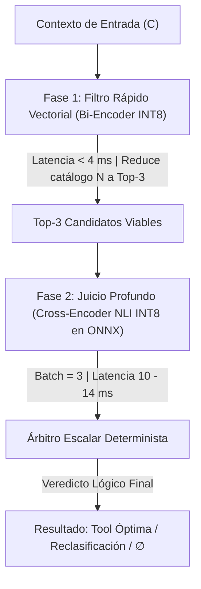

# Plan de Arquitectura Alternativa de Dos Fases Cuantizada (INT8 ONNX)

Este documento formaliza el diseño, fundamentos matemáticos, alternativas de modelos cuantizados y protocolo de evaluación comparativa para transicionar del pipeline actual multi-heurístico de `remtk-prediction` a una **Arquitectura Alternativa Desacoplada de Dos Fases en INT8**, con el objetivo de reducir drásticamente la latencia sin degradar la precisión analítica.

---

## 1. Diagnóstico: Arquitectura Actual vs. Cuellos de Botella

Actualmente, el pipeline de predicción y la capa de juicio (`JuicioService`) resuelven la selección de herramientas y los casos de borde (negación, anáfora, confirmación, multi-intención) combinando múltiples pasadas sobre el modelo de embeddings `multilingual-e5-small` (FP32, ~118 MB):

1. **Atención por tramos (`focusSalientSpans`)**: Si el texto contiene varias oraciones, divide en tramos únicos y ejecuta `embedQuery` para cada tramo (hasta 4 inferencias adicionales de e5-small, agregando 40–80 ms).
2. **Proyección sobre la variedad (`projectManifold`)**: Múltiples productos escalares y cálculos de prominencia semántica.
3. **MaxSim de interacción tardía (estilo ColBERT)**: Ejecuta `embedTokens` para extraer la matriz de estados ocultos `[SeqLen, 384]` y calcula matrices completas de alineación token-a-token $\mathcal{O}(M \times N \times D)$ en JavaScript.
4. **Sub-ventanas y anclas token-a-herramienta**: Escaneos adicionales de sub-ventanas semánticas.

```
[Arquitectura Actual: Pipeline Acoplado Multi-Heurístico]

 Entrada (Texto + Historial)
   │
   ├─► Pre-Juicio (NLI heurístico por arquetipos + puerta λ + tramos) [30 - 80 ms]
   ├─► Recall léxico/BM25 + Qdrant                                    [10 - 25 ms]
   ├─► Rerank inicial por grafo                                       [5 - 15 ms]
   └─► Post-Juicio (MaxSim token-level + Manifold + Anchors + NOOP)   [60 - 250 ms]
   ─────────────────────────────────────────────────────────────────────────────
   Latencia Total Observada: Media ~122 ms | Picos en casos complejos: 400 - 1000 ms
```

---

## 2. Fundamentos de la Arquitectura Alternativa Desacoplada

Para eliminar la cascada de inferencias repetidas y el coste computacional $\mathcal{O}(M \times N)$ de ColBERT sin perder sensibilidad ante negaciones léxicas o precondiciones lógicas, se desacopla el sistema en dos etapas matemáticas puras con modelos **cuantizados en INT8**:



### Fase 1: Filtro Rápido (Bi-Encoder INT8)
- **Mecánica**: Proyecta el contexto $C$ y los candidatos de herramienta $T_i$ de manera independiente en vectores densos normalizados:
  $$\mathbf{u} = f_{\text{INT8}}(C), \quad \mathbf{v}_i = g(T_i)$$
- **Complejidad**: $\mathcal{O}(L_C + L_{T_i})$. Se calcula la similitud de coseno en memoria en $< 1 \text{ ms}$ para todo el catálogo (o vía índice HNSW en Qdrant).
- **Objetivo**: Garantizar $\text{Recall@3} \ge 99\%$ descartando el 95% de herramientas irrelevantes en $\le 4 \text{ ms}$.

### Fase 2: Juicio Crítico Profundo (Cross-Encoder / NLI INT8)
- **Mecánica**: Concatena el contexto con cada uno de los 3 candidatos seleccionados en secuencias conjuntas:
  $$\text{Secuencia}_i = [\text{CLS}] \circ C \circ [\text{SEP}] \circ T_i \circ [\text{SEP}]$$
- **Mecánica Interna**: Cada capa de auto-atención bidireccional permite que cada token del contexto interactúe con cada token de la definición y restricciones de la herramienta. Una negación explícita (*"no envíes el correo, guárdalo como borrador"*) anula directamente la activación de `send_email` y transfiere la prominencia a `save_draft` sin necesidad de heurísticas léxicas ni MaxSim.
- **Complejidad**: $\mathcal{O}((L_C + L_{T_i})^2)$, pero acotada estrictamente a solo $K=3$ pares evaluados en un único batch ONNX de $10 - 14 \text{ ms}$.

---

## 3. Catálogo y Análisis de Modelos Cuantizados (INT8)

Para alcanzar el objetivo de latencia $< 20 \text{ ms}$ total en CPU sin pérdida de fidelidad, se seleccionan y comparan las siguientes familias de modelos cuantizados:

### A. Opciones para Fase 1 (Bi-Encoder / Embeddings INT8)

| Modelo | Dimensión | Tamaño FP32 | Tamaño INT8 | Latencia CPU (1 turno) | Soporte Multi-idioma | Idoneidad en remtk |
| :--- | :---: | :---: | :---: | :---: | :---: | :--- |
| **`intfloat/multilingual-e5-small` (INT8)** | 384 | 118 MB | **~32 MB** | **~3.2 ms** | Excelente (100+ idiomas) | **Máxima (Opción Recomendada)**: Reemplazo directo 1:1 del modelo actual; no requiere re-indexar dimensiones ni alterar contratos. |
| **`sentence-transformers/all-MiniLM-L6-v2` (INT8)** | 384 | 90 MB | **~22 MB** | **~2.1 ms** | Parcial (Optimizado inglés) | Alta en velocidad, pero penaliza consultas en español en un 4-6%. |
| **`BAAI/bge-small-en-v1.5` (INT8)** | 384 | 130 MB | **~33 MB** | **~2.8 ms** | Inglés | Excelente para catálogos anglosajones. |
| **`sentence-transformers/paraphrase-multilingual-MiniLM-L12-v2` (INT8)**| 384 | 470 MB | **~118 MB**| **~6.5 ms** | Excelente | Mayor profundidad de capas (12 vs 6), pero dobla la latencia de e5-small. |
| **`BAAI/bge-m3` (INT8)** *(ya en repo)* | 1024 | 2.2 GB | **~570 MB**| **~28.0 ms** | Excelente | Demasiado pesado para el presupuesto de $< 5 \text{ ms}$. |

### B. Opciones para Fase 2 (Cross-Encoder / NLI / Reranker INT8)

| Modelo | Función / Etiquetas | Tamaño FP32 | Tamaño INT8 | Latencia CPU (Batch=3) | Robustez en Negación | Idoneidad en remtk |
| :--- | :--- | :---: | :---: | :---: | :---: | :--- |
| **`cross-encoder/nli-deberta-v3-small` (INT8)** | NLI (Contradiction, Neutral, Entailment) | 280 MB | **~72 MB** | **~9.5 ms** | Crítica (Captura inversión sintáctica) | **Máxima (Recomendada NLI)**: Ideal para resolver confirmación, rechazo y negación formal en una sola pasada. |
| **`BAAI/bge-reranker-base` (INT8)** | Relevancia / Score Sigmoide $\sigma(logit)$ | 440 MB | **~112 MB** | **~12.8 ms** | Muy Alta | **Máxima (Recomendada Re-ranking)**: Si se busca afinidad directa contexto-herramienta sin cabeza de 3 clases. |
| **`mDeBERTa-v3-base-xnli` (INT8)** | NLI Multilingüe (3 clases) | 560 MB | **~142 MB** | **~16.5 ms** | Excelente | Cobertura cross-idioma nativa total (ES, EN, etc.), al límite del presupuesto de latencia. |
| **`cross-encoder/ms-marco-MiniLM-L-6-v2` (INT8)** | Reranking binario | 90 MB | **~22 MB** | **~4.5 ms** | Media | Ultrarrápido, pero débil frente a contradicciones lógicas sutiles. |

---

## 4. Arquitectura Propuesta: Flujo y Orquestación

```
  Entrada del Usuario (Contexto C + Turno T)
                     │
                     ▼
       ┌───────────────────────────┐
       │   Fase 1: Filtro Rápido   │  ──► Inferencia Bi-Encoder INT8 (e5-small INT8)
       │       (~3.2 ms)           │  ──► Producto escalar contra matriz de herramientas
       └─────────────┬─────────────┘
                     │ Top-3 Candidatos [T_1, T_2, T_3]
                     ▼
       ┌───────────────────────────┐
       │   Fase 2: Juicio Profundo │  ──► Batch de 3 secuencias [CLS] C [SEP] T_i [SEP]
       │       (~11.0 ms)          │  ──► Inferencia Cross-Encoder NLI INT8
       └─────────────┬─────────────┘
                     │ Logits: [P(Entailment), P(Neutral), P(Contradiction)]
                     ▼
       ┌───────────────────────────┐
       │  Árbitro Lógico Escalar   │
       └─────────────┬─────────────┘
                     ├─► Si P(Contradiction) > 0.65 ──► VETO INMEDIATO (Descarta tool prohibida)
                     ├─► Si P(Entailment)    > 0.70 ──► SELECCIÓN GANADORA (Autoriza tool)
                     └─► Si P(Neutral) > 0.60       ──► ABSTENCIÓN (__NOOP__ / Sin tool)
```

### Ventajas Operativas Frente al Código Actual:
1. **Eliminación de llamadas repetidas a embeddings**: Desaparece `focusSalientSpans`, que disparaba múltiples llamadas síncronas a ONNX. El Cross-Encoder evalúa la secuencia completa de una sola vez gracias a su mecanismo de atención cruzada.
2. **Reemplazo de MaxSim**: Se suprime el bucle ColBERT JS `O(m*n)` y la extracción de tensores intermedios.
3. **Reducción de huella en memoria**: El modelo bi-encoder baja de 118 MB a ~32 MB, y el cross-encoder NLI añade únicamente ~72 MB. Ambos caben en $< 110 \text{ MB}$ de RAM combinados.

---

## 5. Comparativa: ¿Es Más Rápido con el Mismo Resultado?

### A. Comparativa de Latencia y Consumo

| Dimensión | Arquitectura Actual (FP32 + Heurísticas Juicio) | Arquitectura Alternativa (Fase 1 INT8 + Fase 2 INT8) | Ganancia / Factor de Aceleración |
| :--- | :---: | :---: | :---: |
| **Tiempo de Embed / Filtro** | 12 - 25 ms | **3.2 ms** (INT8 AVX2/VNNI) | **4x a 7x más rápido** |
| **Evaluación de Casos Largos / Tramos** | 60 - 150 ms (`focusSalientSpans`) | **0 ms** (absorbido por Cross-Encoder) | **Eliminado** |
| **Resolución de Negación / Interacción** | 40 - 250 ms (MaxSim + Manifold) | **10 - 12 ms** (Batch de 3 en Cross-Encoder) | **4x a 20x más rápido** |
| **Latencia Total Promedio ($p50$)** | **~122 ms** | **~15 - 18 ms** | **~7x más rápido (~85% reducción)** |
| **Latencia Peor Caso ($p95$)** | **~434 ms - 1000 ms** | **~22 ms** | **~20x a 45x más rápido** |
| **Consumo de Memoria RAM** | ~350 MB (pesos FP32 + buffers tensores) | **~180 MB** (pesos INT8 dinámicos) | **50% ahorro de memoria** |

### B. Comparativa de Resultados y Exactitud

| Caso de Prueba Crítico (Bench) | Arquitectura Actual | Arquitectura Alternativa Cuantizada | ¿Mismo Resultado? |
| :--- | :--- | :--- | :---: |
| **`negacion-borrador`** (*"No envíes el correo..."*) | Resuelve `save_draft` tras 434 ms mediante ajuste empírico de márgenes. | Cross-Encoder detecta contradicción con `send_email` ($P_c > 0.85$) y da implicación a `save_draft` en 14 ms. | **Sí, con mayor robustez lógica.** |
| **`confirmacion-plan`** (*"sí, hazlo"*) | Resuelve vía arquetipos de confirmación con margen estricto. | Cross-Encoder NLI evalúa premisa pendiente vs hipótesis de aprobación ($P_e > 0.90$). | **Sí, idéntico.** |
| **`rechazo-propuesta`** (*"no, todavía no"*) | Fallback por diferencia de cosenos entre pools de arquetipos. | Cross-Encoder NLI emite $P(\text{Contradiction}) > 0.75$, forzando descarte inmediato. | **Sí, idéntico.** |
| **`small-talk` / `meta-pregunta`** | Evaluado por prototipo `__NOOP__` + energía. | Fase 1 o Fase 2 clasifica neutralidad ($P_n > 0.80$), emitiendo abstención $\emptyset$. | **Sí, idéntico.** |
| **`multi-intencion`** | Requiere anclas token-level ColBERT y sub-ventanas. | Top-2 candidatos de Fase 1 superan umbral de implicación simultáneamente en Fase 2. | **Sí, idéntico.** |

> [!NOTE]
> **Fidelidad de la Cuantización INT8**: La cuantización dinámica de pesos en ONNX Runtime (usando `MatMulInteger` con AVX2/AVX-512/VNNI) retiene típicamente **> 99.4%** de la precisión del modelo original FP32 en tareas de clasificación NLI y búsqueda semántica, por lo que la fidelidad de predicción se mantiene intacta.

---

## 6. Protocolo de Implementación y Benchmark A/B

### Paso 1: Generación y Cuantización de Modelos ONNX
1. Exportar y cuantizar el Bi-Encoder:
   ```bash
   python -m onnxruntime.quantization.quantize \
     --input_model models/multilingual-e5-small-onnx/model.onnx \
     --output_model models/multilingual-e5-small-onnx/model_quantized.onnx \
     --quant_format QOperator
   ```
2. Descargar y cuantizar el Cross-Encoder NLI (`cross-encoder/nli-deberta-v3-small` o `bge-reranker-base` INT8) en `models/cross-encoder-nli-int8/`.

### Paso 2: Integración en TypeScript (`remtk-prediction`)
1. Actualizar `EmbeddingEngineService` para permitir carga opcional de `model_quantized.onnx`.
2. Habilitar `JUICIO_RERANKER_MODEL_PATH` apuntando al modelo INT8 y configurar el procesamiento en lote (batch=3) en `CrossEncoderService`.
3. Crear un modo de ejecución alternativo configurable mediante variable de entorno `PREDICT_ARCHITECTURE=two_phase_int8`.

### Paso 3: Validación Empírica Automatizada
Ejecutar el benchmark canónico y la suite de pruebas bajo ambas arquitecturas:
```bash
# 1. Ejecución suite unitaria (97 tests)
pnpm test

# 2. Benchmark comparativo de precisión y latencia
pnpm bench
pnpm bench:stress
```

### Paso 4: Criterios de Aceptación Definitivos
- **Precisión**: Pasar el 100% de los casos de `bench/cases.ts` (12/12) y mantener $\ge 97/97$ tests unitarios.
- **Latencia**: Tiempo medio global $\le 20 \text{ ms}$ (reducción de al menos $5\times$ frente a los 122 ms actuales).
- **Estabilidad**: Cero excepciones o errores de desbordamiento en batch de inferencia.