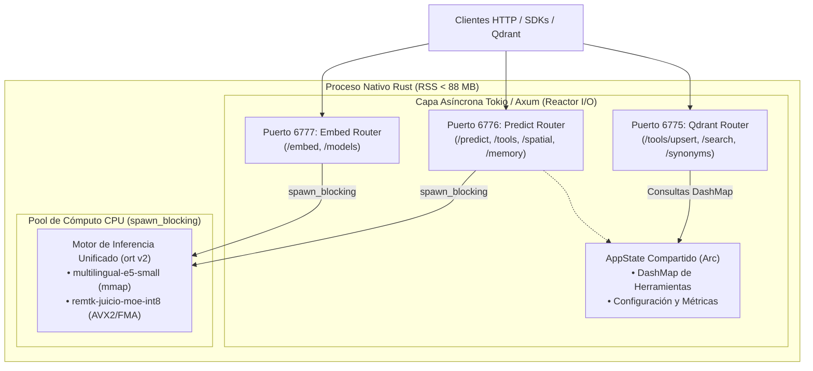

# Arquitectura 01: Topología del Servidor Concurrente en Rust

## 1. Topología Multi-Puerto en un Solo Binario

A diferencia de la arquitectura anterior en Node.js donde existían tres aplicaciones de NestJS separadas (o múltiples procesos para escuchar en los puertos `6776`, `6777` y `6775`), en Rust un **único proceso binario** administra los tres puertos concurrentemente sobre el mismo bucle de eventos asíncrono impulsado por **Tokio** y **Axum**.



---

## 2. Prevención de Bloqueo del Bucle de Eventos (Reactor Starvation)

### 2.1. El Peligro del Bloqueo en Async Rust
En Rust con Tokio, las funciones `async` deben ceder el control cooperativamente (`.await`). Si un manejador HTTP ejecuta una inferencia matemática pesada de matriz en el hilo del reactor (por ejemplo, los 18.5M parámetros del MoE o las 12 capas Transformer de `e5-small`), ese hilo de Tokio queda bloqueado durante 4 a 15 ms. Si todos los hilos del pool asíncrono se bloquean simultáneamente, el servidor no puede responder peticiones ligeras (`GET /health`) ni aceptar nuevos handshakes TCP.

### 2.2. Solución: Despacho a `spawn_blocking` con Canal Acotado
Para garantizar latencias sub-milisegundo en peticiones no computacionales:
1. Las peticiones HTTP llegan al reactor asíncrono de Axum.
2. La decodificación JSON se realiza en el hilo async mediante `serde_json`.
3. La ejecución del pipeline de tensores se despacha al pool de bloqueo de Tokio:
   ```rust
   let engine = state.engine.clone();
   let result = tokio::task::spawn_blocking(move || {
       engine.predict(input)
   }).await??;
   ```
4. El hilo asíncrono queda libre instantáneamente para atender otras conexiones de red mientras los hilos de CPU ejecutan instrucciones vectoriales SIMD de ONNX Runtime.

---

## 3. Estado Compartido Global (`AppState`)

El estado del servidor se comparte entre los tres routers de Axum utilizando punteros con recuento de referencias atómicas (`Arc`):

```rust
use std::sync::Arc;
use dashmap::DashMap;

pub type TenantId = String;

#[derive(Clone)]
pub struct AppState {
    /// Motor de inferencia ONNX unificado (e5-small + remtk-juicio-moe-int8)
    pub engine: Arc<InferenceEngine>,
    /// Caché de herramientas en memoria indexadas por inquilino
    pub tool_cache: Arc<DashMap<TenantId, Arc<ToolRegistry>>>,
    /// Configuración del sistema leída desde variables de entorno
    pub config: Arc<AppConfig>,
    /// Métricas Prometheus de latencia y conteos
    pub metrics: Arc<MetricsRecorder>,
}
```

---

## 4. Implementación del Servidor Principal (`src/main.rs`)

A continuación se presenta la arquitectura completa del arranque concurrente de los tres puertos con manejo de señales de apagado elegante:

```rust
// src/main.rs
use std::net::SocketAddr;
use std::sync::Arc;
use tokio::signal;
use tracing::{info, error};

mod config;
mod engine;
mod registry;
mod routes;
mod state;

use crate::config::AppConfig;
use crate::engine::InferenceEngine;
use crate::state::AppState;

#[tokio::main]
async fn main() -> Result<(), Box<dyn std::error::Error>> {
    // 1. Inicializar observabilidad estructurada con tracing-subscriber
    tracing_subscriber::fmt()
        .with_env_filter(tracing_subscriber::EnvFilter::from_default_env())
        .json()
        .init();

    info!("Iniciando remtk-prediction-server en Rust nativo...");

    // 2. Cargar configuración desde entorno
    let config = Arc::new(AppConfig::from_env()?);

    // 3. Inicializar motor de inferencia ONNX (carga mmap de modelos)
    let engine = Arc::new(InferenceEngine::new(&config.models_path)?);

    // 4. Construir estado compartido global
    let state = AppState {
        engine,
        tool_cache: Arc::new(dashmap::DashMap::new()),
        config: config.clone(),
        metrics: Arc::new(metrics::MetricsRecorder::new()),
    };

    // 5. Configurar los routers de Axum para cada puerto
    let app_predict = routes::predict::create_router(state.clone());
    let app_embed = routes::embed::create_router(state.clone());
    let app_qdrant = routes::qdrant::create_router(state.clone());

    let addr_predict: SocketAddr = format!("0.0.0.0:{}", config.port_predict).parse()?;
    let addr_embed: SocketAddr = format!("0.0.0.0:{}", config.port_embed).parse()?;
    let addr_qdrant: SocketAddr = format!("0.0.0.0:{}", config.port_qdrant).parse()?;

    // 6. Bind de los tres listeners TCP independientes
    let listener_predict = tokio::net::TcpListener::bind(addr_predict).await?;
    let listener_embed = tokio::net::TcpListener::bind(addr_embed).await?;
    let listener_qdrant = tokio::net::TcpListener::bind(addr_qdrant).await?;

    info!("→ Puerto 6776 [Predict] activo en http://{}", addr_predict);
    info!("→ Puerto 6777 [Embed]   activo en http://{}", addr_embed);
    info!("→ Puerto 6775 [Qdrant]  activo en http://{}", addr_qdrant);

    // 7. Ejecución concurrente con apagado elegante unificado
    tokio::select! {
        res = axum::serve(listener_predict, app_predict).with_graceful_shutdown(shutdown_signal()) => {
            if let Err(e) = res { error!("Error en servidor predict: {}", e); }
        }
        res = axum::serve(listener_embed, app_embed).with_graceful_shutdown(shutdown_signal()) => {
            if let Err(e) = res { error!("Error en servidor embed: {}", e); }
        }
        res = axum::serve(listener_qdrant, app_qdrant).with_graceful_shutdown(shutdown_signal()) => {
            if let Err(e) = res { error!("Error en servidor qdrant: {}", e); }
        }
    }

    info!("Apagado elegante completado. Todos los sockets cerrados.");
    Ok(())
}

async fn shutdown_signal() {
    let ctrl_c = async {
        signal::ctrl_c().await.expect("Fallo al registrar listener de Ctrl+C");
    };

    #[cfg(unix)]
    let terminate = async {
        signal::unix::signal(signal::unix::SignalKind::terminate())
            .expect("Fallo al registrar listener de SIGTERM")
            .recv()
            .await;
    };

    #[cfg(not(unix))]
    let terminate = std::future::pending::<()>();

    tokio::select! {
        _ = ctrl_c => info!("Señal Ctrl+C recibida, iniciando drenado de peticiones..."),
        _ = terminate => info!("Señal SIGTERM recibida, iniciando drenado de peticiones..."),
    }
}
```

---

## 5. Pipeline de Middlewares con Tower

Cada router incorpora capas de middleware configuradas a través de `tower`:

```rust
// src/routes/predict.rs
use axum::{routing::{get, post}, Router};
use tower::ServiceBuilder;
use tower_http::trace::TraceLayer;
use tower_http::cors::CorsLayer;
use tower_http::timeout::TimeoutLayer;
use std::time::Duration;
use crate::state::AppState;

pub fn create_router(state: AppState) -> Router {
    let middleware_stack = ServiceBuilder::new()
        .layer(TraceLayer::new_for_http())
        .layer(TimeoutLayer::new(Duration::from_secs(10)))
        .layer(CorsLayer::permissive());

    Router::new()
        .route("/health", get(health_handler))
        .route("/predict", post(predict_handler))
        .route("/spatial/predict", post(spatial_predict_handler))
        .route("/predict/route", post(fast_path_route_handler))
        .route("/memory/predict", post(memory_predict_handler))
        .route("/tools", post(tools_register_handler))
        .route("/tools/count", get(tools_count_handler))
        .route("/debug", get(debug_handler))
        .layer(middleware_stack)
        .with_state(state)
}
```
