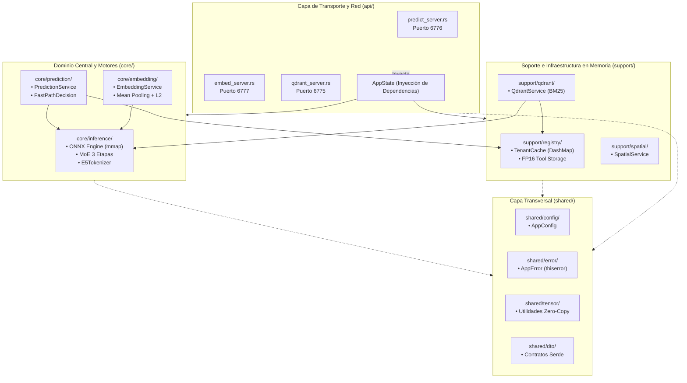

# Arquitectura 05: Monolito Modular en Rust (Inspirado en `key-remtk/src`)

## 1. Visión General del Monolito Modular

Para evitar que el servidor de inferencia en Rust se convierta en una maraña de rutas acopladas a detalles de tensores y sesiones ONNX, la estructura de `rust-server/src` adopta formalmente el patrón de **Monolito Modular**, tomando como referencia directa el diseño de dominio implementado en `key-remtk/src`.

Este arquetipo desacopla de forma tajante la lógica matemática pura del negocio (`core/`), las capacidades de soporte e infraestructura (`support/`), las estructuras transversales (`shared/`) y la capa de transporte y red (`api/`).

---

## 2. Desglose Estructural de Módulos

### 2.1. `core/`: Motores de Negocio e Inferencia Pura
Contiene las matemáticas y la toma de decisiones. **Tiene cero dependencias de Axum, HTTP o sockets.** Puede compilarse y ejecutarse en entornos CLI, workers de fondo o pruebas unitarias aisladas.

* **`core/inference/`:**
  * Administra las sesiones `ort::InferenceSession` cargadas mediante páginas de memoria mapeada de solo lectura (`mmap`).
  * Ejecuta la tokenización canónica con `E5Tokenizer` respetando prefijos `query: ` y `passage: `.
  * Implementa el cabezal decisor de 3 etapas `remtk-juicio-moe-int8` (Compuerta NLI, 6 Expertos de Interacción y Set-Transformer de abstención).
* **`core/prediction/`:**
  * `PredictionService`: Orquesta la extracción de tokens de consulta y contexto, el filtrado de candidatas desde el registro en memoria, el cálculo de brecha de scores (`gap threshold`) y el evaluador de `Fast-Path` para omitir llamadas redundantes al planificador LLM.
* **`core/embedding/`:**
  * `EmbeddingService`: Encapsula la generación de embeddings normalizados L2 (384 dimensiones) y la introspección de metadatos de modelos (`GET /models`).

### 2.2. `support/`: Capacidades de Apoyo e Infraestructura
Provee servicios que apoyan al dominio central, gestionando la memoria física y las integraciones.

* **`support/registry/`:**
  * `TenantCache` y `ToolRegistry`: Gestiona el almacenamiento multi-inquilino en `Arc<DashMap<String, Arc<ToolRegistry>>>`.
  * Reduce el consumo de RAM en un $50\%$ almacenando los tensores de tokens de herramientas en media precisión (`half::f16` a 73.7 KB por herramienta).
  * Realiza el ensamblado continuo Zero-Copy del tensor 3D de herramientas candidatas `Array3<f32>` en $< 0.05\text{ ms}$.
* **`support/spatial/`:**
  * `SpatialService`: Resuelve la predicción en lienzos visuales interactivos mediante coordenadas de cursor, distancias euclidianas y anáforas de interfaz.
* **`support/qdrant/`:**
  * `QdrantService`: Simula y actúa como proxy de las operaciones de recuperación léxica BM25, conteo de herramientas y expansión de sinónimos.

### 2.3. `shared/`: Tipos Transversales y Contratos
* **`shared/config/`:** `AppConfig` fuertemente tipado con lectura desde variables de entorno y fallbacks idénticos a los del entorno TypeScript.
* **`shared/error/`:** `AppError` gobernado por `thiserror` con conversión limpia a códigos HTTP y JSON estándar.
* **`shared/tensor/`:** Funciones de vectorización SIMD para normalización L2, similitud coseno y conversiones FP16 $\leftrightarrow$ FP32.
* **`shared/dto/`:** Estructuras Serde de entrada y salida para todos los contratos JSON.

### 2.4. `api/`: Capa de Transporte y Entrega HTTP
Es el único módulo que conoce a **Axum** y **Tower**.
* **`api/predict_server.rs`:** Expone los endpoints del Puerto 6776 (`/predict`, `/spatial/predict`, `/predict/route`, `/memory/predict`, `/tools`, `/tools/count`, `/debug`, `/health`). Despacha las inferencias intensivas al pool de bloqueo `tokio::task::spawn_blocking`.
* **`api/embed_server.rs`:** Expone el Puerto 6777 (`/embed`, `/models`, `/health`).
* **`api/qdrant_server.rs`:** Expone el Puerto 6775 (`/tools/upsert`, `/tools/count`, `/tools/search`, `/memories/search`, `/tools/synonyms`, `/status`, `/health`).
* **`api/state.rs`:** `AppState` como contenedor de inyección de dependencias que expone punteros atómicos `Arc` hacia los servicios.
* **`api/mod.rs`:** Ensambla los routers y los middlewares (`TraceLayer`, `CorsLayer`, `TimeoutLayer`).

---

## 3. Beneficios de Ingeniería y Escalabilidad Horizontal

| Dimensión | Monolito Tradicional Acoplado | Monolito Modular (Implementado) |
| :--- | :--- | :--- |
| **Aislamiento de Cómputo** | Rutas HTTP llaman a ONNX directamente | Capa `api/` despacha a `core/` vía `spawn_blocking` |
| **Facilidad de Testing** | Requiere mockear routers y sockets TCP | `core/` y `support/` se prueban con `cargo test` puro |
| **Extracción a Microservicios** | Imposible sin reescribir código | `core/embedding` o `support/spatial` se pueden mover a crates independientes en minutos |
| **Manejo de Memoria RAM** | Tensores dispersos en controladores | Centralizado en `support/registry` en `half::f16` |
| **Mantenibilidad** | Código spaghetti de cientos de líneas | Módulos pequeños con una sola responsabilidad |
